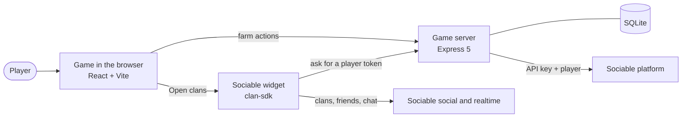

# Harvest Village

[](https://gitlab.com/clan-platform/demo-game/-/pipelines)


A cozy farming browser game, and the demo game of **Sociable**: it shows how a real game with its own accounts
adds clans, friends and live chat with the Sociable SDK. Players buy seeds, plant, wait, harvest and sell; the
server is the single authority for coins, inventory, crop growth and rewards.

Live at https://game.130-61-158-79.sslip.io.



| Part | Tech |
| --- | --- |
| Frontend | React + Vite (plain JavaScript), plain CSS, hand-drawn SVG icons |
| Backend | Express 5 + TypeScript, `zod` validation, `helmet` |
| Database | SQLite via Node's built-in `node:sqlite`, migrations applied on startup |
| Tests | Vitest + Supertest (backend), Vitest (frontend), an end-to-end script against a real server |

## Contents

- [Installation](#installation)
- [Usage](#usage)
- [Documentation](#documentation)
- [Contributing](#contributing)
- [Known issues](#known-issues)
- [Authors and contact](#authors-and-contact)
- [License](#license)

## Installation

You need [Node.js](https://nodejs.org/) 22.13 or newer (LTS 22 or 24). There are no native modules, so nothing
needs compiling.

```bash
git clone https://gitlab.com/clan-platform/demo-game.git
cd demo-game
npm install
npm run dev
```

Open http://localhost:5173. The database is created at `backend/data/harvest.db` on the first start. Copying
`.env.example` to `.env` is optional: farming needs no settings. The clan widget needs a Sociable API key; see
[docs/clan-integration.md](docs/clan-integration.md).

Running it next to Studio (port 5174), on Windows, or as one production process: [docs/running.md](docs/running.md).

## Usage

1. Register a player, or in dev mode click **Create demo accounts** and log in as `demo_alice`
   (and as `demo_bob` in a private window, for a second player).
2. Pick a seed, tap an empty plot to plant it, and harvest it when it glows.
3. Sell crops in the **Barn** and buy seeds in the **Seed Shop**. Harvests earn XP; level 2 unlocks pumpkins.
4. Press **Open clans** to open the Sociable widget: clans, friends and chat.

```bash
npm test          # backend and frontend tests
npm run e2e       # starts a real server and plays the whole loop
npm run build && npm start    # production build on http://localhost:3001
```

## Documentation

| Read | For |
|---|---|
| [docs/running.md](docs/running.md) | Every way to run it, demo players, tests |
| [docs/how-to-play.md](docs/how-to-play.md) | Rules, crops and levels |
| [docs/architecture.md](docs/architecture.md) | The API, security, unique usernames, account deletion |
| [docs/clan-integration.md](docs/clan-integration.md) | Signing players in to Sociable and showing the widget |
| [docs/deployment.md](docs/deployment.md) | Docker, the image pipeline, deploying to the server |
| [docs/limitations.md](docs/limitations.md) | What it does not do yet |

## Contributing

- **Bugs and ideas:** open a ticket in the team's tracker (`TEAM-<number>`) or an issue in this project, with the
  steps to repeat it.
- **Branches:** start from `develop`, for example `fix/TEAM-123-harvest-timer` or `feat/TEAM-124-new-crop`.
- **Commits:** `type(scope): what changed (TEAM-123)`, where the type is `feat`, `fix`, `docs`, `refactor` or `test`.
- **Merge requests:** into `develop` (protected), with `npm test` passing. The game's numbers live in
  `backend/src/game/catalog.ts`; the server stays the authority for every reward.
- **Releases:** `develop` is merged into `main`, and the CI deploys `main` to the server.

## Known issues

One process and SQLite with one writer, so it is built for a demo, not for scale; no email or password reset; the
farm size and unlock levels are fixed in code. The full list is in [docs/limitations.md](docs/limitations.md).

## Authors and contact

Built by the Sociable team at Xsolla School Baku:

- Murad Hasanli
- Nuray Mukhtarli
- Farida Shakikhanli

Questions and support: sociableplatform.support@gmail.com.

## License

No license has been chosen yet, so all rights are reserved by the authors.
